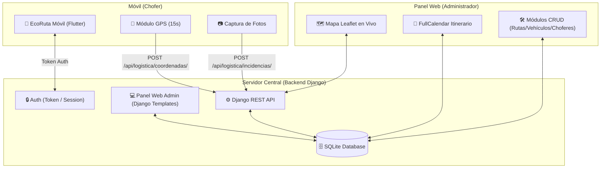
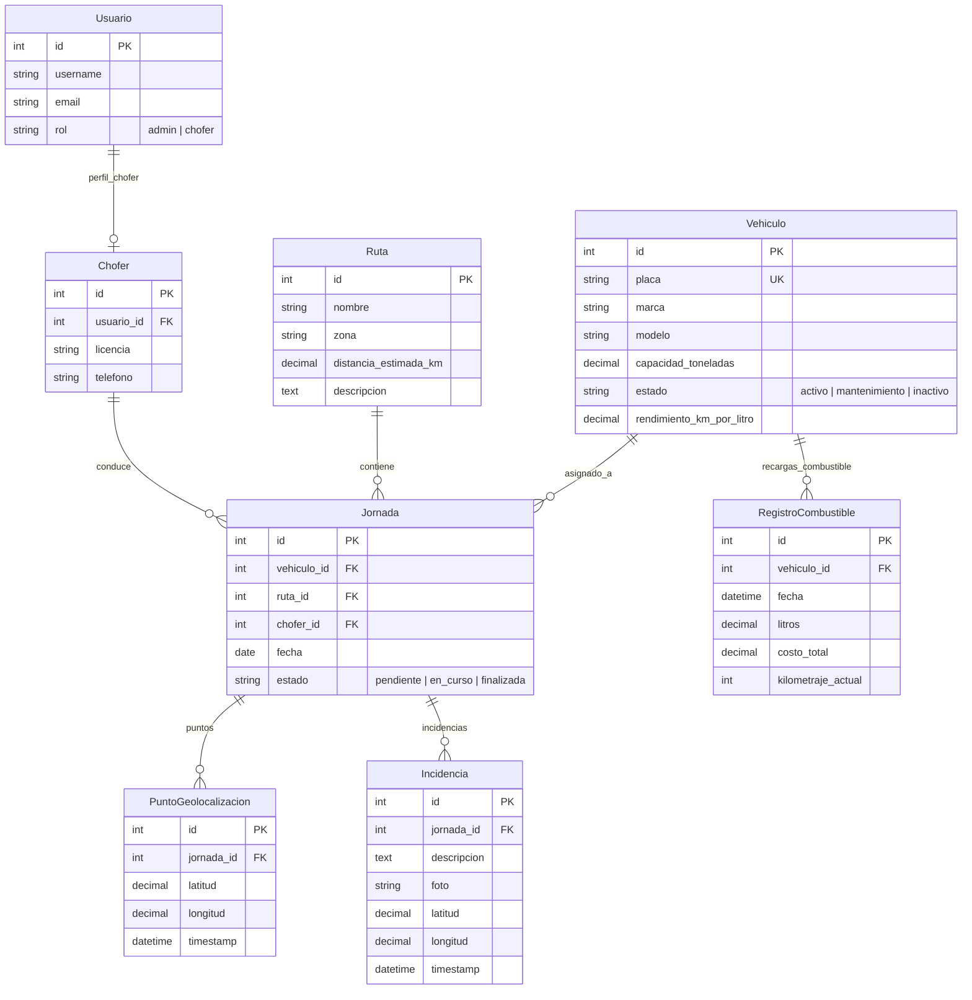

# 🌿 Manual de Usuario y Radiografía Técnica EcoRuta — Plataforma de Gestión de Rutas Ecológicas

Bienvenido al **Manual de Usuario y Documento de Arquitectura de EcoRuta**. Este documento explica de forma resumida, clara y completa cómo operar el sistema **EcoRuta**, tanto desde la **Plataforma Web (Administrador)** como desde la **Aplicación Móvil (Chofer)**, e incluye la **Radiografía Técnica** detallada del proyecto.

---

## 📌 1. Visión General del Sistema

EcoRuta consta de dos módulos integrados:
1. **EcoRuta Backend & Panel Web** (`ecoruta_backend`): Plataforma administrativa construida en Django para supervisar rutas, vehículos, conductores, combustible y monitoreo GPS en tiempo real. Habilita funciones completas de **Guardar, Modificar y Eliminar** en todos sus módulos.
2. **EcoRuta Móvil** (`ecoruta_frontend`): Aplicación móvil construida en Flutter para que los choferes registren el recorrido GPS automático de su jornada y reporten incidencias con fotografía.

---

## 🌐 2. Guía del Panel Web Administrador

### 🔑 2.1 Acceso al Sistema
- **URL Local**: [http://127.0.0.1:8000/dashboard/](http://127.0.0.1:8000/dashboard/)
- **URL Móvil / Red Local**: `http://192.168.1.106:8000/dashboard/`
- **URL Panel Admin Django**: [http://127.0.0.1:8000/admin/](http://127.0.0.1:8000/admin/)
- **Credenciales por defecto**:
  - **Administrador**: Usuario `admin` | Contraseña `admin123`
  - **Conductores de prueba**: `chofer1`, `chofer2`, `chofer3` | Contraseña `chofer123`
- **Nota de seguridad**: el panel administrativo solo acepta cuentas con rol `admin`/`is_staff`. Un conductor que intente abrir `/dashboard/` será redirigido a su panel móvil `/chofer/`. Los accesos de demostración se ocultan con `DEBUG=False`.

---

### 📊 2.2 Secciones del Dashboard Web (`/dashboard/`)

#### A. Resumen Ejecutivo (`/dashboard/`)
- Muestra tarjetas dinámicas con indicadores clave:
  - 🚚 **Vehículos Activos**
  - 🗺️ **Jornadas Planificadas Hoy**
  - ⚠️ **Incidencias Registradas**
- Gráfico interactivo de **Efectividad Semanal de Recolección (Toneladas)**.

#### B. Gestión de Rutas Ecológicas (`/dashboard/rutas/`)
- Directorio interactivo de rutas con indicadores de Zona, Distancia (Km) y Descripción.
- **Guardar**: Haz clic en **"Guardar Nueva Ruta"** para abrir el modal de creación.
- **Modificar**: Haz clic en el botón azul **"Modificar"** para actualizar la información de una ruta.
- **Eliminar**: Haz clic en el botón rojo 🗑️ **"Eliminar"** con confirmación modal de seguridad.

#### C. Gestión de Conductores y Personal (`/dashboard/conductores/`)
- Directorio de Choferes encargados del transporte de recolección.
- **Guardar Conductor**: Registra nuevos usuarios y asigna licencias y teléfonos.
- **Modificar Conductor**: Actualiza la licencia y datos de contacto.
- **Eliminar Conductor**: Elimina el registro del chofer y su cuenta de usuario asociada.

#### D. Planificación de Itinerarios (`/dashboard/itinerario/`)
- Vista de calendario interactivo (**FullCalendar**) para consultar asignaciones por fecha.
- **Asignar Nueva Jornada**: Haz clic en **"+ Asignar Nueva Jornada"** para vincular vehículo, ruta, chofer y fecha.
- **Listado y Eliminación**: Tabla al pie del calendario para **Eliminar** jornadas programadas.

#### E. Monitoreo en Vivo en Mapa (`/dashboard/mapa/`)
- Mapa interactivo GPS (**Leaflet**) que muestra la ubicación exacta de los camiones de recolección en servicio.
- Marcadores de **incidencias en tiempo real** reportadas por los choferes desde la aplicación móvil.

#### F. Gestión de Recursos y Flota (`/dashboard/recursos/`)
- Control de recargas de combustible (Litros y Costo total).
- **Guardar Carga**: Registra nuevas recargas de combustible.
- **Eliminar Carga**: Elimina registros de recargas erróneos.
- **Flota de Vehículos**: Tarjetas interactivas para **Guardar**, **Modificar** y **Eliminar** camiones de la flota.

---

## 📱 3. Guía de la Aplicación Móvil (Chofer)

### 🔑 3.1 Inicio de Sesión
- Abre la app `ecoruta_frontend`.
- Ingresa las credenciales del conductor:
  - **Chofer de Prueba**: Usuario `chofer1` | Contraseña `chofer123`
- Presiona **"Ingresar"**.

---

### 🚚 3.2 Iniciar y Ejecutar Jornada
1. En la pantalla principal, presiona **"Iniciar Jornada"**.
2. La app solicitará permisos de ubicación GPS. Al aceptarlos, se activará el **rastreo en tiempo real**.
3. Las coordenadas (latitud y longitud) se enviarán automáticamente cada 10 segundos al servidor central.

---

### 🚨 3.3 Reportar Incidencia con Foto
Si ocurre un obstáculo durante la ruta (falla mecánica, vía cerrada, derrame, etc.):
1. Presiona el botón rojo **"Reportar Incidencia"**.
2. Escribe una descripción breve del evento.
3. Presiona **"Tomar Foto"** para capturar la evidencia con la cámara.
4. Presiona **"Enviar Reporte"**. Las coordenadas exactas y la foto se registrarán de inmediato en el mapa del Administrador.

---

### 🛑 3.4 Finalizar Jornada
Al concluir el recorrido de recolección:
1. En la pantalla de ruta activa, presiona **"Finalizar Jornada"**.
2. El rastreo GPS automático se detendrá de inmediato.

---

## 🛠️ 4. Guía Rápida de Comandos de Inicio

Para iniciar los servidores manualmente desde la consola:

### Iniciar Backend Django:
```powershell
cd ecoruta_backend
..\venv\Scripts\python.exe manage.py runserver 0.0.0.0:8000
```

### Iniciar Frontend Flutter (Navegador o Windows):
```powershell
cd ecoruta_frontend
flutter run -d chrome
```

---

## 📡 5. Radiografía Técnica y Arquitectura del Proyecto

### 5.1 Diagrama de Arquitectura del Sistema



---

### 5.2 Modelo de Datos Relacional (Diagrama ERD)



---

### 5.3 Matriz de Cobertura de Funcionalidades CRUD

| Entidad / Módulo | Crear (Guardar) | Leer (Listar) | Modificar (Editar) | Eliminar (Borrar) | Estado de Implementación |
| :--- | :---: | :---: | :---: | :---: | :--- |
| **Rutas Ecológicas** | ✅ | ✅ | ✅ | ✅ | 100% Completo (`/dashboard/rutas/`) |
| **Conductores / Choferes** | ✅ | ✅ | ✅ | ✅ | 100% Completo (`/dashboard/conductores/`) |
| **Vehículos de Flota** | ✅ | ✅ | ✅ | ✅ | 100% Completo (`/dashboard/recursos/`) |
| **Cargas de Combustible** | ✅ | ✅ | ⚠️ (Re-crear) | ✅ | 90% Completo (`/dashboard/recursos/`) |
| **Jornadas / Itinerarios** | ✅ | ✅ | ⚠️ (Estado) | ✅ | 95% Completo (`/dashboard/itinerario/`) |
| **Monitoreo GPS en Vivo** | ✅ | ✅ | N/A | N/A | 100% Completo (`/dashboard/mapa/`) |
| **Reporte de Incidencias** | ✅ (Móvil) | ✅ (Web Map) | N/A | N/A | 100% Completo (Fotos + GPS) |

---

### 5.4 Oportunidades de Mejora y Diagnóstico Técnico

1. **Base de Datos Geoespacial (PostGIS + PostgreSQL)**:
   - Migración de `DecimalField` a campos geográficos nativos `django.contrib.gis` para calcular distancias exactas y áreas de cobertura (`Polygon`).
2. **Comunicación en Tiempo Real (Django Channels + WebSockets)**:
   - Transmisión instantánea de la ubicación GPS de los camiones al mapa Web sin sobrecarga por HTTP polling.
3. **Algoritmos de Optimización de Rutas (OR-Tools / OSRM)**:
   - Cálculo automatizado de trayectorias con menor consumo de combustible considerando el tráfico.
4. **Notificaciones Push y mapas sin conexión**:
   - Alertas nativas al chofer cuando se asigna una jornada y caché de teselas para operar en zonas sin cobertura.
5. **Respaldo y observabilidad**:
   - Respaldos automáticos de PostgreSQL, monitoreo de errores (Sentry) y métricas de disponibilidad del servicio.

---
*EcoRuta v1.0 — Innovación y Eficiencia en Gestión Ecológica de Rutas*
