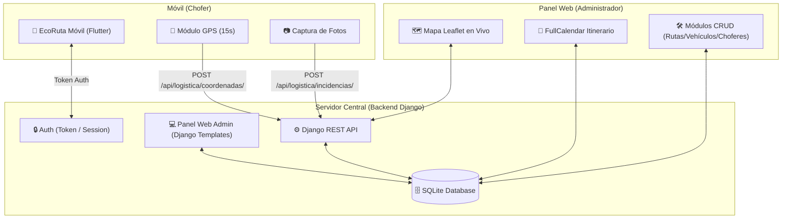
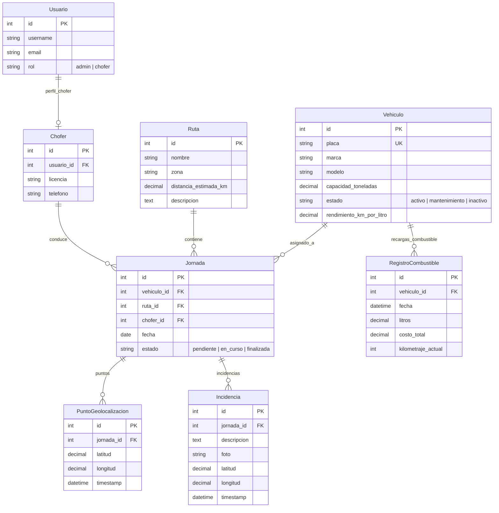
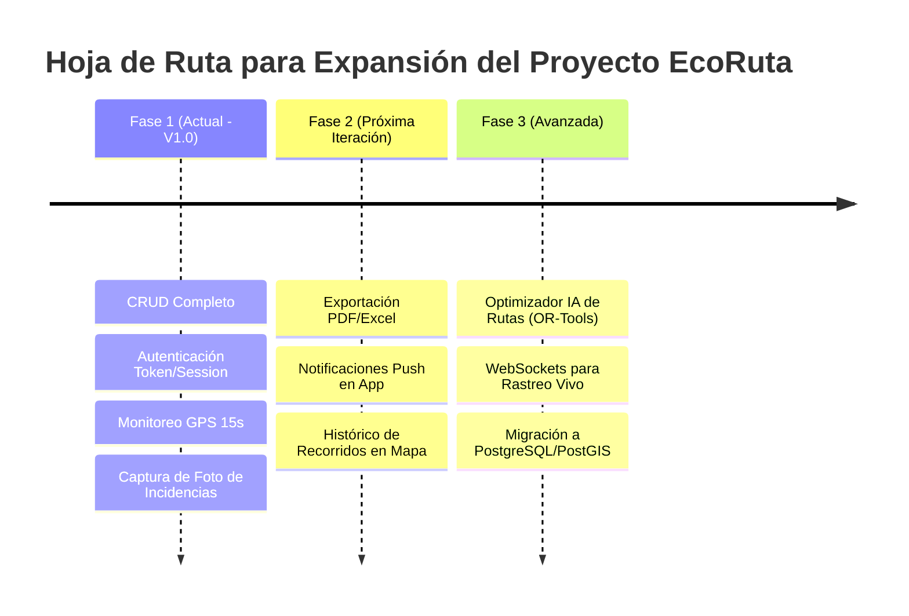

# 📡 Radiografía Técnica Exhaustiva: Proyecto EcoRuta

Este documento proporciona una **radiografía técnica integral y detallada** del proyecto **EcoRuta — Plataforma de Gestión y Monitoreo de Rutas Ecológicas de Recolección**. Está estructurado para permitir una revisión exhaustiva con cualquier herramienta externa de análisis, auditar el sistema completo y servir como base para la incorporación de nuevas funcionalidades.

---

## 🏗️ 1. Resumen Ejecutivo y Arquitectura del Sistema

**EcoRuta** es un sistema distribuido que combina un **Backend REST API en Django**, un **Panel Web Administrador (Glassmorphic SPA)** y una **Aplicación Móvil Híbrida en Flutter** para choferes de unidades de recolección.



---

## 🗄️ 2. Modelo de Datos y Esquema ERD

La base de datos relacional modela el dominio de logística ecológica y control de recolección.



---

## 💻 3. Desglose de Componentes del Proyecto

### 3.1 Backend & Dashboard Web (`ecoruta_backend`)
- **Tecnologías**: Python 3.10+, Django 5.x, Django REST Framework, SQLite, Leaflet.js, FullCalendar 6, Chart.js.
- **Módulos / Apps**:
  - `security`: Modelo `Usuario` personalizado con roles (`admin`, `chofer`), autenticación de sesión y token API.
  - `administracion`: Modelos `Ruta`, `Vehiculo`, `Chofer`, `RegistroCombustible`. Vistas y formularios CRUD completos para el panel web.
  - `logistica`: Modelos `Jornada`, `PuntoGeolocalizacion`, `Incidencia`. Endpoints de la REST API consumidos por la app móvil.
  - `dashboard`: Interfaz administrativa con diseño Glassmorphism, métricas en tiempo real, mapas interactivos y formularios modales.

### 3.2 Frontend Móvil (`ecoruta_frontend`)
- **Tecnologías**: Dart 3.x, Flutter 3.x, Provider (State Management), Geolocator, Image Picker, Http.
- **Pantallas**:
  - `LoginScreen`: Autenticación contra `/api/auth/login/` con almacenamiento seguro de Token.
  - `HomeScreen`: Selección e inicio de jornada de trabajo activa.
  - `RouteActiveScreen`: Rastreo GPS continuo cada 15 segundos y botón de reporte de emergencia.
  - `IncidentScreen`: Formulario con cámara para capturar foto de la evidencia y enviar coordenadas GPS.

---

## 📋 4. Matriz de Funcionalidades y Cobertura CRUD

| Módulo / Entidad | Crear (Guardar) | Leer (Listar/Detalle) | Modificar (Editar) | Eliminar (Borrar) | Estado de Implementación |
| :--- | :---: | :---: | :---: | :---: | :--- |
| **Rutas Ecológicas** | ✅ | ✅ | ✅ | ✅ | 100% Completo (Vista dedicada `/dashboard/rutas/`) |
| **Conductores / Choferes** | ✅ | ✅ | ✅ | ✅ | 100% Completo (Vista dedicada `/dashboard/conductores/`) |
| **Vehículos de Flota** | ✅ | ✅ | ✅ | ✅ | 100% Completo (Módulo `/dashboard/recursos/`) |
| **Cargas de Combustible** | ✅ | ✅ | ⚠️ (Re-crear) | ✅ | 90% Completo (Módulo `/dashboard/recursos/`) |
| **Jornadas / Itinerario** | ✅ | ✅ | ⚠️ (Cambiar Estado) | ✅ | 95% Completo (FullCalendar + Tabla `/dashboard/itinerario/`) |
| **Rastreo GPS en Vivo** | ✅ | ✅ | N/A | N/A | 100% Completo (Leaflet Mapa `/dashboard/mapa/`) |
| **Reporte de Incidencias** | ✅ (Móvil) | ✅ (Web Map) | N/A | N/A | 100% Completo (Captura de Foto + Coordenadas) |

---

## 🛠️ 5. Oportunidades de Mejora y Diagnóstico Técnico

Para potenciar la aplicación en una revisión técnica avanzada o futura tesis de maestría/grado, se sugieren los siguientes puntos de optimización:

### A. Base de Datos y Consultas Geoespaciales
- **Diagnóstico actual**: Las coordenadas de GPS (`latitud`, `longitud`) se almacenan como `DecimalField`.
- **Mejora Propuesta**: Migrar la base de datos a **PostgreSQL + Extensiones PostGIS** utilizando `django.contrib.gis`. Permite calcular distancias geométricas exactas, áreas de recolección (`Polygon`) y geocercas (`Geofencing`).

### B. Comunicación en Tiempo Real (Sockets vs Polling)
- **Diagnóstico actual**: El mapa Web y la App Móvil utilizan llamadas HTTP periódicas.
- **Mejora Propuesta**: Integrar **Django Channels + WebSockets** (Redis Backed) para transmitir la posición de los camiones al mapa del administrador con cero latencia y sin sobrecargar el servidor web con peticiones HTTP.

### C. Algoritmos de Optimización de Rutas (Núcleo de Inteligencia)
- **Diagnóstico actual**: Las rutas tienen una distancia estimada fija definida manualmente.
- **Mejora Propuesta**: Integrar **Google OR-Tools** o **Open Source Routing Machine (OSRM)** para calcular la ruta óptima de menor consumo de combustible en función del tráfico y volumen de contenedores.

### D. Seguridad y Variables de Entorno
- **Diagnóstico actual**: `SECRET_KEY` e IP de servidores están codificadas en `settings.py`.
- **Mejora Propuesta**: Implementar `python-dotenv` para cargar variables sensibles desde un archivo `.env` fuera del repositorio Git.

### E. Módulo de Reportación y Exportación
- **Diagnóstico actual**: Métricas visuales en pantalla con gráficos Chart.js.
- **Mejora Propuesta**: Agregar exportación de reportes semanales/mensuales de rendimiento y toneladas recolectadas en formatos **PDF (ReportLab)** y **Excel (openpyxl)**.

---

## 🚀 6. Hoja de Ruta para Nuevas Funcionalidades (Roadmap)



1. **Próximo Sprint (Fase 2)**:
   - **Histórico de Recorridos**: Permitir al administrador seleccionar una fecha pasada y reproducir la trayectoria exacta del camión en el mapa mediante una línea animada (Polyline).
   - **Exportador PDF/Excel**: Botón en "Gestión de Recursos" para descargar el balance de combustible en PDF.
   - **Notificaciones Push**: Avisar al chofer en el teléfono cuando se le asigne una nueva jornada de trabajo.

---

## 📌 7. Estructura de Directorios del Código Fuente

```text
App Django Gabriel/
├── ecoruta_backend/               # Código Fuente Servidor Django
│   ├── administracion/            # CRUD Rutas, Vehículos, Choferes, Combustible
│   │   ├── forms.py               # Formularios Django
│   │   ├── models.py              # Modelos de Datos de Administración
│   │   ├── urls.py                # Endpoints de vistas administrativas
│   │   └── views.py               # Lógica de negocio CRUD
│   ├── dashboard/                 # Interfaz Web Administrador
│   │   ├── templates/dashboard/   # Vistas HTML (rutas.html, conductores.html, etc.)
│   │   └── views.py               # Renderizadores del panel web
│   ├── logistica/                 # API REST (Jornadas, GPS, Incidencias)
│   ├── security/                  # Usuario y Roles (Admin / Chofer)
│   ├── EcoRuta/                   # Configuración global (settings.py, urls.py)
│   └── manage.py
├── ecoruta_frontend/              # Código Fuente Aplicación Móvil Flutter
│   ├── lib/
│   │   ├── providers/             # Manejo de Estado (Auth, GPS)
│   │   ├── screens/               # Pantallas (Login, Home, Ruta, Incidencia)
│   │   └── services/              # Cliente HTTP REST API
│   └── pubspec.yaml               # Dependencias de Flutter
├── MANUAL_DE_USUARIO.md           # Guía rápida para operar el sistema
└── RADIOGRAFIA_PROYECTO_ECORUTA.md # Este documento de auditoría técnica
```
